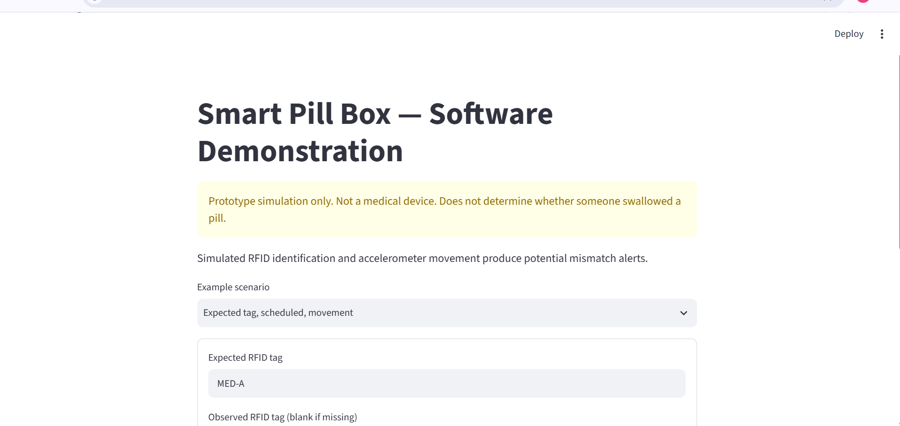
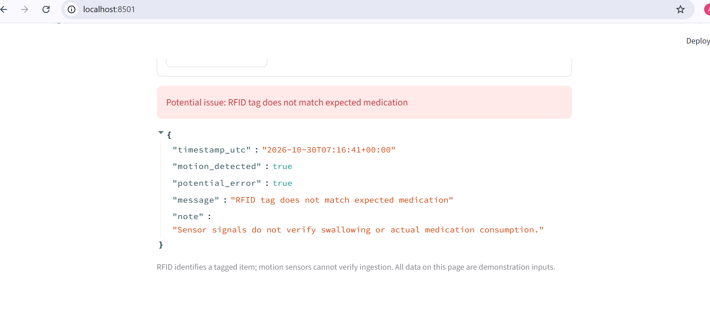
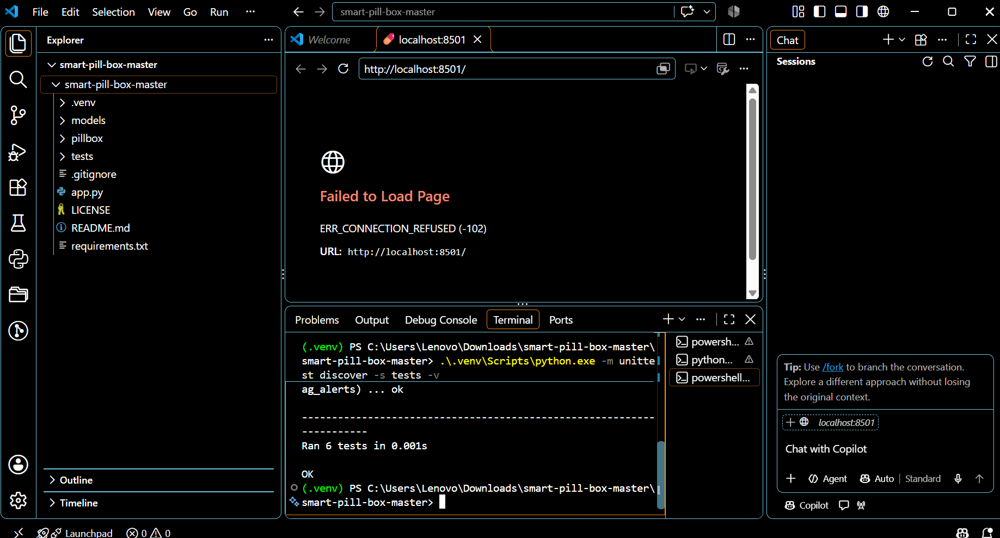

# Smart Pill Box — Software Demonstration

A **simulated** medication-handling monitoring prototype that combines an RFID identifier and accelerometer-style movement readings to flag *potential* errors. Created as a GitHub-ready **reference implementation** based on the Smart Pill Box concept; it is **not** a representation of a previously trained or validated model.

> **Important:** This software cannot verify that a pill was consumed, cannot ensure a medication is correct, and is not suitable for medical decisions. All scenarios and training samples are synthetic. No real RFID reader or accelerometer is connected.

## Features
- Interactive Streamlit interface for manual or simulated sensor inputs
- Rule-based alerts for unexpected tag, missing identification during movement, or movement outside schedule
- A separately trainable Random Forest **illustration** trained on synthetic labels derived from the same rules (not a validated medical ML system)
- Unit tests for decision rules

## Tech stack
Python, Streamlit, scikit-learn (optional training), joblib.

## Run
```bash
python -m venv .venv
# Activate .venv (Windows): .venv\Scripts\activate
# macOS/Linux: source .venv/bin/activate
pip install -r requirements.txt
streamlit run app.py
```

## Optional synthetic ML illustration
```bash
python -m pillbox.ml
```
Reported test metrics evaluate synthetic rule-derived labels only. They are **not** evidence of detection accuracy on real patients or hardware.

## Run tests
```bash
python -m unittest discover -s tests -v
```

## System flow
`Simulated RFID tag + simulated acceleration + schedule -> software rules -> on-screen alert`

## Contributions and hardware boundaries
The reference implementation demonstrates the **software** concept. In the academic team project, hardware was handled by a project partner; the author reports contributing software and ML training. **Original training data, model code/weights, integration traces, and validation results have not been supplied for this reference repository.** Add those assets only once verified, and document separately.

## Planned real integration (not implemented)
- Serial/MQTT adapter for authenticated hardware events
- Real reader-specific RFID decoding and accelerometer calibration
- Timestamped logging with access control and privacy protections
- Proper medication schedule validation, fail-safe warnings, clinician review and controlled testing

## Interview talking points
Why RFID tag IDs are identifiers, why movement is not equivalent to swallowing, differences between rule-based thresholds and ML, and limits of simulated evaluation.
## Application Demo

The screenshots below demonstrate simulated RFID and motion monitoring. This prototype is not a medical device and cannot verify medication ingestion.

### Application Dashboard


### Simulated RFID Mismatch Alert


### Automated Test Results
All 6 included automated tests passed locally.


